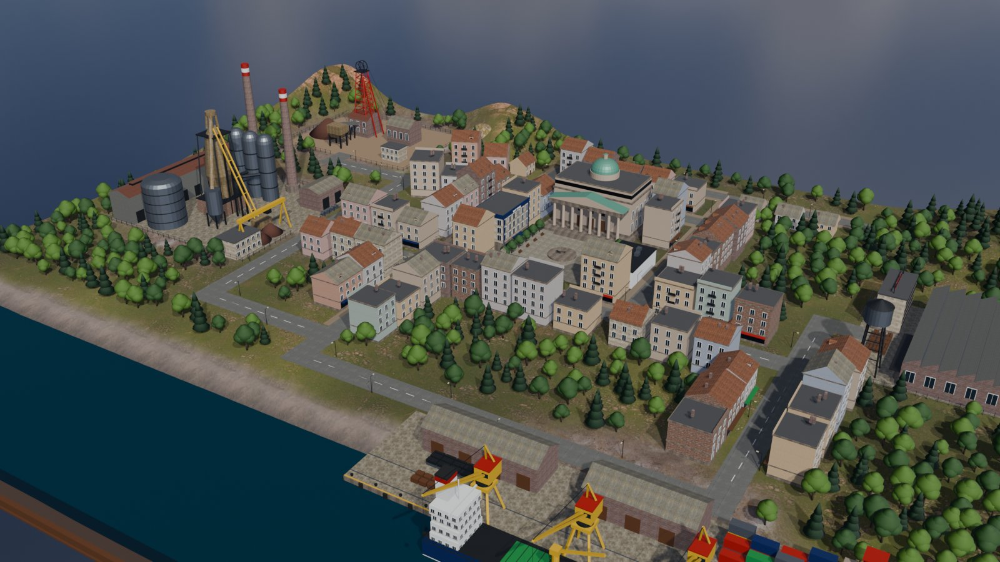

# Hossa: miasteczko na giełdzie

Żywa makieta gospodarki połączona z giełdą. Miasteczko w 3D — kopalnia, huta, fabryka, port,
sieć sklepów i bank — produkuje i handluje samo, a każda z tych firm jest notowana na giełdzie
w centrum. Kursy nie są losowane: powstają w prawdziwym arkuszu zleceń, w którym boty
inwestorów reagują na to, co dzieje się na makiecie (strajk, sztorm, wyniki kwartalne,
decyzja banku centralnego).

> Projekt w budowie. Gotowe są silnik giełdy, gospodarka miasteczka, rynek z botami
> (na razie w terminalu: `pnpm sesja`) i makieta 3D z Blendera. Scena w przeglądarce
> i interfejs powstają etapami.



```
packages/engine    arkusz zleceń (port Parkietu)          zero zależności
packages/economy   gospodarka miasteczka, zdarzenia, wieści  zero zależności
packages/market    giełda: arkusze sześciu spółek + boty    engine + economy
apps/sesja         sesja w terminalu                        market
blender/           makieta 3D budowana skryptami Pythona    Blender 5.1
tools/model        optymalizacja GLB + testy kontraktu      gltf-transform
```

## Gospodarka miasteczka (`packages/economy`)

Sześć spółek w jednym łańcuchu dostaw. Kopalnia Rudawa (RUD) wydobywa rudę, którą ciężarówki
wożą do Huty Stalwar (STW). Stal jedzie do Fabryki Motorek (MTK) i do Bałtportu (BPT), skąd
co kilka dni statek zabiera eksport. Pensje z całego miasta wracają do Sieci Koszyk (KSZ),
a Bank Grosz (GRS) pożycza wszystkim i płaci odsetki od lokat mieszkańców.

- **Księga podwójnego zapisu.** Każdy przepływ pieniędzy to przelew między dwoma kontami
  (spółki, mieszkańcy, reszta świata), więc suma wszystkich sald jest stała co do grosza —
  test sprawdza to po każdym dniu na losowych ziarnach.
- **Zysk memoriałowy.** Sprzedaż eksportowa liczy się w chwili wysyłki do portu; sztorm
  opóźnia pieniądze, ale nie kasuje sprzedaży (za to port płaci za postój statków).
- **Wycena** = roczny zysk (średnia z ~30 dni) × 1 / (stopa procentowa + premia za ryzyko)
  ÷ liczba akcji. Podwyżka stóp obniża mnożnik od razu, a wyższe odsetki — zyski z czasem.
  Straty jednorazowe (odpis złych kredytów) obniżają majątek, nie przyszłe zyski.
- **Zdarzenia** z zadanym prawdopodobieństwem dziennym: strajk, wypadek, nowe złoże, drogi
  węgiel, duży kontrakt, awaria, sztorm, spadek nastrojów, złe długi; do tego posiedzenia banku
  centralnego co 45 dni, sezon świąteczny i wyniki kwartalne. Każde zdarzenie trafia do
  wiadomości z wydźwiękiem dla każdej spółki, której dotyczy — także dla odbiorców
  w łańcuchu dostaw (strajk w kopalni to też zła wiadomość dla huty).

## Rynek (`packages/market`)

Każda spółka ma własny arkusz z silnika i ośmiu graczy: animatora rynku, trzech inwestorów
fundamentalnych (różne opóźnienia i poglądy), gracza na newsach, gracza momentum i dwóch
losowych. Kurs powstaje z ich zleceń.

- Gracz na newsach reaguje od razu i często przesadza; fundamentalni dociągają cenę do wyceny
  z opóźnieniem — stąd przestrzelenia i korekty.
- Animator poszerza spread i wycofuje się, gdy rynek robi się nerwowy — płynność znika wtedy,
  kiedy jest najbardziej potrzebna.
- Każda transakcja przenosi akcje i gotówkę między dwoma graczami: suma pozycji i suma
  gotówki wszystkich graczy to zawsze zero.

### Testy kontrfaktyczne

Jak sprawdzić, że „strajk obniża kurs”, skoro rynek i tak ciągle się rusza? Ta sama sesja
(to samo ziarno) uruchamiana jest dwa razy: bez zdarzenia i z ręcznie wstrzykniętym. Gospodarka
losuje zawsze tyle samo razy dziennie, a każdy bot ma własny generator, więc oba przebiegi
różnią się wyłącznie skutkami tego jednego zdarzenia. Testy sprawdzają m.in., że strajk
w kopalni obniża kurs kopalni, a potem huty; że podwyżka stóp obniża indeks; że dobra
wiadomość podnosi kurs tego samego dnia, zanim zmienią się zyski.

```bash
pnpm sesja --seed 42 --dni 180
```

## Silnik giełdy (`packages/engine`)

Arkusz zleceń z kojarzeniem według ceny, a potem czasu (price-time priority) — port domeny
silnika [Parkiet](https://github.com/Sitkowski01/parkiet-exchange) z Javy do TypeScriptu,
żeby giełda działała w przeglądarce bez serwera.

- Zlecenia `LIMIT` i `MARKET`, anulowanie, głębokość arkusza, migawka.
- Zdarzenia `RESTED`, `TRADE`, `CANCELLED` — te same co w Parkiecie, co do pola.
- Ceny w groszach jako liczby całkowite, nigdy ułamki.
- Deterministyczny: ta sama sekwencja zleceń zawsze daje te same zdarzenia.
- Zero zależności — działa w Node, w przeglądarce i w Web Workerze.
- Arkusz sam waliduje każde zlecenie: w przeglądarce zlecenia przychodzą też z JSON-a i z workera,
  gdzie typy TypeScriptu już nie istnieją.

Różnice względem Parkietu, świadome:

- Maksymalna wielkość zlecenia to milion akcji, nie miliard. Java liczy na `long`, a JavaScript
  na `number`, dokładnym tylko do 2^53 — przy tym limicie obrót zlecenia zawsze jest dokładny.
- Port obejmuje kojarzenie, anulowanie, głębokość i migawkę. Odbudowy arkusza z dziennika zdarzeń
  (event sourcing po restarcie serwera) w przeglądarce nie potrzeba, więc jej nie przeniesiono.

### Jak sprawdzamy, że port jest wierny

| Test | Co sprawdza |
|---|---|
| jednostkowe | każde zachowanie arkusza osobno |
| różnicowy (fast-check) | setki losowych scenariuszy: wynik identyczny z naiwnym arkuszem, którego poprawność widać gołym okiem |
| niezmienniki (fast-check) | arkusz nigdy skrzyżowany, ilość zlecenia = transakcje + reszta, LIMIT nie handluje gorzej niż jego cena |
| zgodność z Parkietem | ~3000 poleceń nagranych z silnika w Javie (`tools/golden/GoldenVectors.java`) — port musi dać identyczne zdarzenia |
| mutacyjne (Stryker) | czy testy łapią celowo wprowadzone błędy; próg 90% |

## Makieta 3D (`blender/`)

Makieta nie jest klikana ręcznie w Blenderze. Powstaje w całości ze skryptów Pythona
(`blender/hossa/`), więc da się ją odtworzyć jedną komendą i przejrzeć w diffie:

- `layout.json` to jedno źródło prawdy o układzie: gdzie stoją firmy, gdzie biegną drogi
  i którędy jeżdżą ciężarówki. Czyta go skrypt makiety i będzie go czytać scena w przeglądarce.
- Tekstury PBR pochodzą z [Poly Haven](https://polyhaven.com) (CC0) i są pobierane przy
  pierwszym budowaniu. Teren dostaje jedną teksturę złożoną w numpy z trawy, ziemi przy
  zakładach, plaży i skał, bo glTF nie przenosi mieszania materiałów z węzłów Blendera.
- Każdy budynek to jedna siatka (`kit.Builder`), żeby przeglądarka rysowała mniej obiektów.
  Ruchome części są osobno: koła wyciągowe, dźwigi, statek, zwały rudy i pas notowań na
  giełdzie. Puste węzły oznaczają punkty zaczepienia, np. szczyty kominów (dym) i bramy
  zakładów (ciężarówki).
- Drzewa, latarnie i auta trafiają do GLB jako kilka wzorców plus lista pozycji
  w `makieta.json`. Przeglądarka rysuje je instancjami.
- `tools/model` odchudza GLB z ~34 MB do ~6 MB: tekstury WebP, siatki skwantyzowane
  i skompresowane meshopt.

Testy kontraktu (`tools/model`) sprawdzają gotową paczkę:

- czy w GLB są obiekty i punkty zaczepienia, po których scena szuka kominów i dźwigów,
- czy każda trasa ciężarówki jedzie po istniejących drogach i zaczyna się przy bramie
  nadawcy, a kończy przy bramie odbiorcy,
- czy drzewa nie rosną na jezdni,
- czy paczka mieści się w budżecie 15 MB.

Pierwsze uruchomienie tych testów złapało hutę obróconą tyłem do drogi: jej brama wypadała
56 m od trasy ciężarówek.

```bash
# w konsoli Pythona Blendera (5.1): buduje makietę i eksportuje surowy GLB
p = r"<repo>/blender/run.py"; exec(compile(open(p, encoding="utf-8").read(), p, "exec"), {"__file__": p})
# w repo: optymalizacja do apps/web/public/makieta.glb
pnpm model
```

## Uruchomienie

Wymaga Node 24 i pnpm.

```bash
pnpm install
pnpm check      # build, typy, lint, reguły architektury, testy z pokryciem
pnpm mutation   # testy mutacyjne
```

Ponowne nagranie przebiegów z Parkietu (Java 21, klasy po `./gradlew classes` w repo Parkietu):

```bash
java -cp <parkiet>/build/classes/java/main tools/golden/GoldenVectors.java \
  > packages/engine/src/test/parkiet-golden.json
```

## Licencja

MIT
